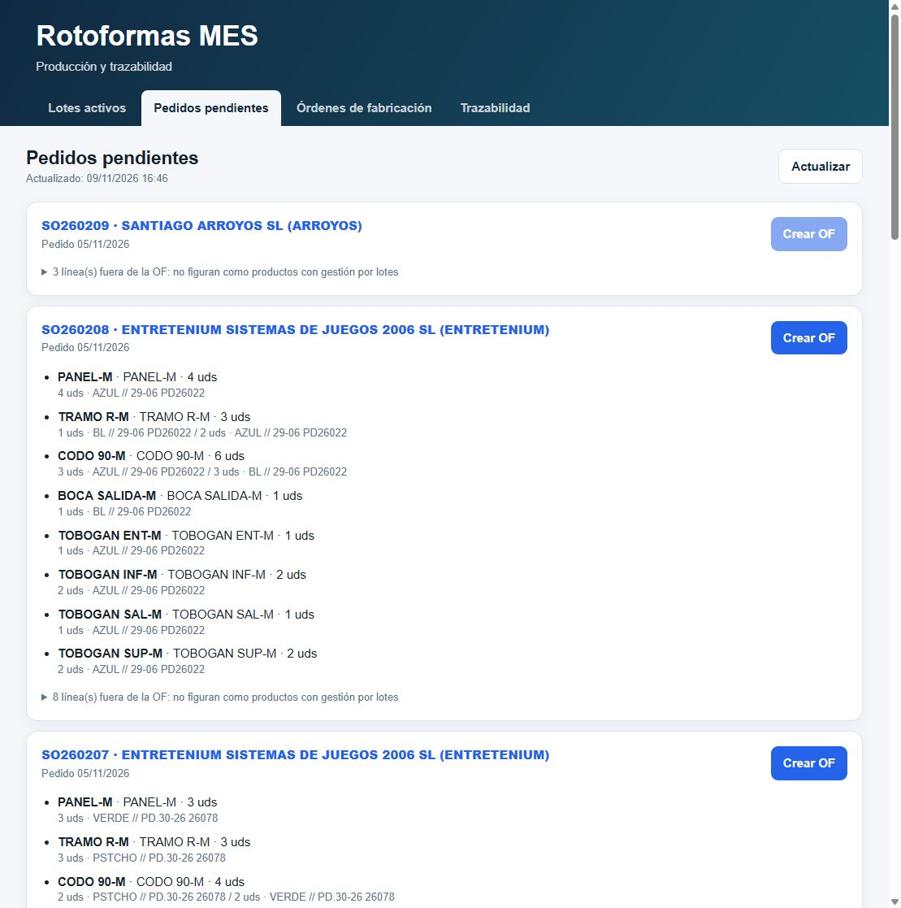

# Entretenium: preparación de gestión por lotes

9 de noviembre de 2026. Estado: **migración ejecutada y verificada**, con autorización explícita del borrado.

Alcance autorizado: versiones -N y -M de BOCA SALIDA, CODO 30, CODO 90, PANEL, TOBOGAN ENT, TOBOGAN INF, TOBOGAN SAL, TOBOGAN SUP, TRAMO R y TUBO T. Son veinte SKU en diez familias con variantes, etiqueta ET.

El usuario excluye expresamente del marcado y de la OF los productos menores del pedido SO260208: ARO-M, SEMIROD B-M, SEMIROD B-N, SEMIROD A-M y SEMIESF 30-M.

## Diagnóstico

- Stock leído: PANEL-N 15 unidades, PANEL-M -6 unidades; los otros dieciocho SKU, cero.
- Peso, precios, costes, etiquetas y almacén se copian por variante.
- El pedido SO260208 contiene identificadores de las familias y variantes originales, además de SKU. El MES agrupa por SKU; después de la migración hay que comprobar el pedido y sus enlaces en Holded, especialmente antes de generar un albarán. No se deben dar esos enlaces por migrados automáticamente.
- El procedimiento anterior elimina cada familia y recrea sus variantes como productos independientes con lotes. Cambian los identificadores; la copia de datos no restaura sus identificadores originales.
- La API de alta utilizada no restaura automáticamente imágenes, campos de categoría ni IVA de compra. BOCA SALIDA tiene IVA de compra configurado. Estos campos requieren revisión posterior; el sufijo N/M permanece.

## Ejecución preparada

`MigrationEntretenium.gs` conserva los helpers de las migraciones previas. `previewMigrationEntretenium` consulta Holded y guarda la copia íntegra en propiedades privadas fragmentadas (`ENT_PREVIEW_*`). No exporta credenciales. `validateMigrationEntretenium` compara las diez familias actuales con la copia, sin escrituras en Holded.

`migrateEntreteniumToLots` es destructiva: solo ejecutarla tras la confirmación del borrado irreversible. Valida todas las familias antes de modificar la primera, bloquea concurrencia y registra operaciones e identificadores en `ENT_MIGRATION_JOURNAL`. Ante un fallo se detiene; no permite repetir ciegamente una ejecución parcial. Una respuesta de red ambigua exige inspección antes de recuperar.

Verificado tras la ejecución: veinte productos y lotes, saldos y almacén conservados, Holded Raw sincronizado y SO260208 habilitado en Pedidos pendientes. Sus 10 líneas elegibles se agrupan en 8 modelos y 20 unidades; 8 líneas de productos menores quedan excluidas. Crear la OF sigue siendo un paso separado.

Pendiente: las líneas comerciales de SO260208 conservan los IDs originales; el MES resuelve por SKU, pero hay que reenlazar los productos en Holded antes de la expedición. También revisar imágenes, IVA de compra y Tipo de plástico, que no copia el alta. No se han modificado ni expedido pedidos, creado OF o registrado fabricación.

Prueba: `node tests/entretenium-migration.cjs` comprueba lista exacta, preservación de stock negativo, cambios desde el diagnóstico, detención y diario ante fallos y prevención de duplicados. No modifica Holded.

El código de preparación está en HEAD de Apps Script. No se han cambiado versiones publicadas ni URLs de las aplicaciones.

## Resultado y recuperación

La primera ejecución se detuvo después de crear TUBO T-N porque Holded devolvió el precio con coma decimal (`235,50`) y se comparaba con `235.50`. Se corrigió la normalización numérica y se añadió recuperación basada en el diario: no se repitieron borrados ni altas confirmadas. Se verificaron precio, coste, precio de compra, peso y stock. Las pruebas incluyen esta recuperación y respuestas con coma decimal.

`finishEntreteniumMigration` verificó la suma de stock por lote, el almacén de PANEL-N/PANEL-M, el contenido del pedido y sincronizó el catálogo.

### Correspondencia de identificadores

| SKU | ID anterior de variante | ID nuevo con lotes | Stock |
|---|---|---|---:|
| TUBO T-N | 69b916742a6b9975b600338d | 6af1e934864f8e7dc308c7a2 | 0 |
| TUBO T-M | 69b916742a6b9975b600338e | 6af1ea220f4a7a4c2e0d27f3 | 0 |
| TRAMO R-N | 69b91616d8eb516c59075d50 | 6af1ea2507ef7f79e1098f33 | 0 |
| TRAMO R-M | 69b91616d8eb516c59075d51 | 6af1ea266bfb8e64ee029286 | 0 |
| TOBOGAN SUP-N | 69b915d6cf49263850011081 | 6af1ea29472f769fa906ec63 | 0 |
| TOBOGAN SUP-M | 69b915d6cf49263850011082 | 6af1ea2b2b5f6221ec017aa4 | 0 |
| TOBOGAN SAL-N | 69b9156176c255cf4f0df4df | 6af1ea2d0f25b4cfac0e81a0 | 0 |
| TOBOGAN SAL-M | 69b9156176c255cf4f0df4e0 | 6af1ea2ed5cfdb792f025ead | 0 |
| TOBOGAN INF-N | 69b91499526a4feb2c0606a3 | 6af1ea30f269075e1b01dddc | 0 |
| TOBOGAN INF-M | 69b91499526a4feb2c0606a4 | 6af1ea324446aa7af30c6cf7 | 0 |
| TOBOGAN ENT-N | 69b90bea4f27c14d7107dc74 | 6af1ea34aed911cf360cbde6 | 0 |
| TOBOGAN ENT-M | 69b90bea4f27c14d7107dc75 | 6af1ea365795acbec400e070 | 0 |
| PANEL-N | 69b901a11dc5bb0ac305b8b7 | 6af1ea38b4596b3f050b878e | 15 |
| PANEL-M | 69b901a11dc5bb0ac305b8b8 | 6af1ea39600f1c57650eef11 | -6 |
| CODO 90-N | 69b9014f55152b8a8c0e8ed8 | 6af1ea3bcbe72247010f326e | 0 |
| CODO 90-M | 69b9014f55152b8a8c0e8ed9 | 6af1ea3d3c5aecc77f0fb45b | 0 |
| CODO 30-N | 69b9010e7a1a7c9a41082325 | 6af1ea3f6d3709e99f034f6a | 0 |
| CODO 30-M | 69b9010e7a1a7c9a41082326 | 6af1ea41f7ccd03f9a004906 | 0 |
| BOCA SALIDA-N | 69b9007e1e29b20a970fd95b | 6af1ea4389b00e2d0a069cd8 | 0 |
| BOCA SALIDA-M | 69b9007e1e29b20a970fd95c | 6af1ea446bfb8e64ee02928d | 0 |
