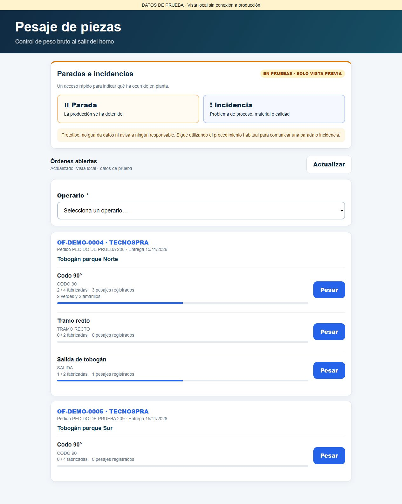
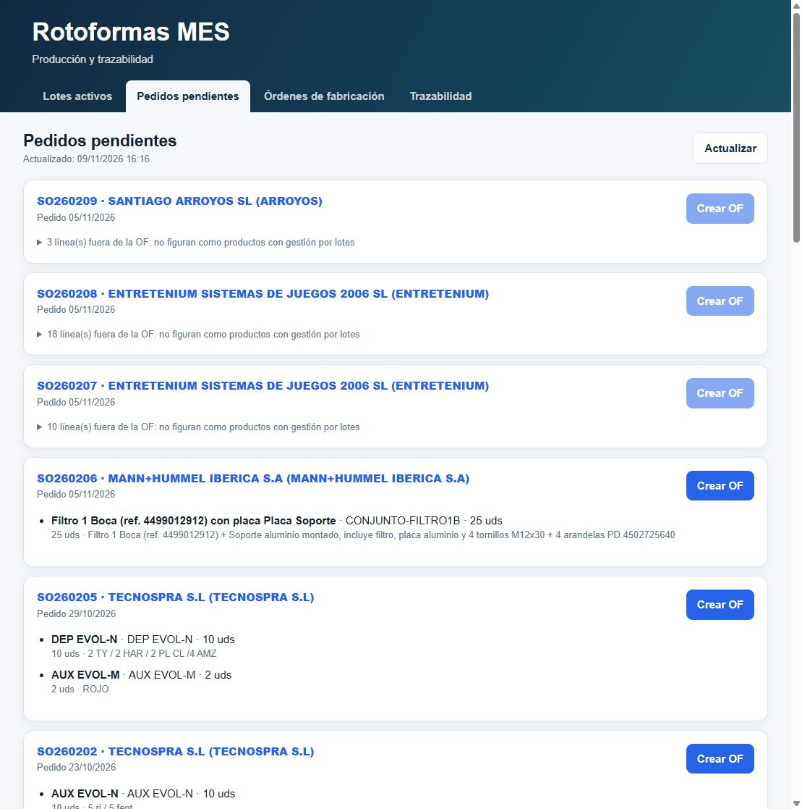

# Órdenes de fabricación con varias piezas

Actualizado el 9 de noviembre de 2026.

Una OF agrupa las piezas de un pedido de venta. Cada SKU tiene su propia línea, lote terminado, materias primas, avance y pesajes. Los colores no son SKU y no crean otro lote: quedan como instrucciones de fabricación.

## Uso en oficina

En «Pedidos pendientes» aparece una tarjeta por pedido con todas las referencias disponibles para fabricar por lotes. «Crear OF» abre una revisión conjunta de las cantidades. Las líneas comerciales repetidas del mismo SKU se suman y sus descripciones se conservan con la cantidad de cada línea.

Se puede añadir una referencia de trabajo, por ejemplo «Tobogán parque Norte», y una fecha objetivo. Las líneas que no figuran en el catálogo de productos con gestión por lotes se muestran como excluidas; no se convierten silenciosamente en fabricación. Si ninguna línea es elegible, la creación está deshabilitada. Revisar el catálogo de Holded si esas piezas también deben fabricarse con trazabilidad.

La creación guarda todas las líneas bajo un único número de OF y prepara un lote Holded por SKU. Cada línea debe configurar su PE y el pigmento opcional en «Materias primas». Si falla la preparación de un lote, la OF permanece guardada y la línea ofrece «Preparar lote» para reintentarlo. El pesaje y la nueva vinculación de producción de esa línea quedan bloqueados hasta prepararlo.

Editar una línea permite ajustar su cantidad, colores e instrucciones. Referencia de trabajo, fecha objetivo y estado se comparten con las demás líneas de esa OF. El SKU no se cambia, ni se renombra el lote por modificar la fecha. Los pedidos ya importados no se vuelven a ofrecer; no se fusionan automáticamente OF históricas que se hubieran creado por separado.

La creación manual de una OF sin pedido mantiene el formulario de una referencia. La creación conjunta de varias piezas se realiza desde el pedido.

## Uso en planta

La cabecera muestra OF, cliente, pedido, referencia de trabajo y entrega. Debajo aparecen todas las piezas, cada una con su botón «Pesar». No hay que abrir la OF para descubrir qué contiene.

Los contadores distinguen unidades fabricadas de pesajes registrados. El diálogo confirma pedido, referencia, SKU, lote y peso teórico antes de guardar. Conserva la lectura de báscula y la preparación de etiquetas mediante Raspberry del sistema existente.

Esta captura es una prueba local de interfaz, no una fabricación real.

## Identificación y compatibilidad

`Ordenes Fabricacion` conserva una fila por SKU y repite el número de OF para las líneas del mismo pedido. La identidad de línea es la pareja **OF y SKU**. No se borran ni migran las filas históricas.

Se añaden al final de esa hoja cuatro columnas: referencia de trabajo, identificadores de líneas comerciales de origen en JSON, estado del lote terminado y detalle del error de preparación.

- La suma de producción, los pesajes, los materiales y el detalle se resuelven por OF y SKU.
- La búsqueda por lote abre directamente esa pieza. Buscar una OF con varias líneas ofrece un selector de modelo.
- Los QR antiguos y el formato del lote `SKU-MMYYYY-OFNNNN` se conservan.
- El número interno de pesada sigue siendo secuencial para toda la OF. Así la clave existente `OF|Pnúmero` de los trabajos Raspberry continúa siendo única. Cada trabajo contiene el SKU, lote, peso y URL de la medición guardada.
- Las llamadas antiguas sin SKU solo se aceptan si la OF tiene una única línea. Una OF con varios modelos exige identificar la pieza.
- Los lotes de PE y pigmento quedan capturados en la fabricación del turno. Reintentar el turno conserva la instantánea de cada SKU.

El resumen de producción sigue agregado por SKU. Si varias OF abiertas pendientes contienen el mismo SKU, la asignación automática se bloquea para revisión. Elegir una OF en pesaje no asigna por sí solo la producción agregada del turno. Tampoco se ha añadido un registro de montaje por tobogán individual.

## Integración y despliegue

Antes de implementar se recuperó el código de Apps Script, que tenía cambios de Raspberry y QR aún no recogidos en GitHub. Se incorporan `HardwareBridge.gs`, `ConfiguracionZebra.gs`, `ShortLinks.gs`, `ShortLinksSettings.html` y `GuestTraceabilityPage.html`, junto con las modificaciones ya existentes en los demás archivos.

La ampliación no ejecuta trabajos físicos al desplegarse. La cola existente continúa preparando la impresión y actualizando V1 del láser sin disparar el marcado. Los enlaces cortos y las URLs de despliegue se conservan. No se cambian claves ni activaciones de equipos.

Publicado el 9 de noviembre de 2026: versión 61 en planta y consulta QR (acceso anónimo, ejecución como propietario); versión 62 en gestión (acceso de dominio, ejecución como usuario y autorización del servidor). Ambas versiones contienen el mismo código y distintos manifiestos. Durante la publicación se detectó y corrigió una aplicación temporal del manifiesto público a gestión; se verificó la restauración de su configuración privada y URL original. En próximas publicaciones deben prepararse manifiestos separados antes de actualizar cada despliegue.

## Verificación

Pruebas automatizadas sin datos reales:

- `tests/multi-piece-orders.cjs`: agrupación por SKU, colores, bloqueo de duplicados y de una revisión obsoleta del pedido, fallo parcial y reintento de lote, aislamiento de PE, pesajes y trazabilidad, trabajos Raspberry distintos, conservación de instantáneas, compatibilidad con OF y QR antiguos y bloqueo de producción ambigua.
- `tests/multi-piece-ui.cjs`: tarjetas agrupadas, dos OF del mismo cliente y modelo, selección explícita de SKU, búsqueda por pedido, texto escapado y selección de modelo desde trazabilidad.
- `tests/order-pigment.cjs`, `tests/order-material-flow.cjs` y `tests/plant-events-ui.cjs`: regresión de materiales, stock e interfaz de incidencias.

Revisión visual local de la tarjeta en pantalla grande y a 390 píxeles de ancho, del diálogo de pesaje y de la creación conjunta. Las pruebas locales no envían consumos, pesajes ni trabajos a equipos reales.

Verificación en la aplicación publicada: acceso privado correcto, lectura de lotes y pedidos de Holded y agrupación de los modelos en un único pedido. No se crearon OF, pesajes ni movimientos reales para validar el cambio. No se ha probado físicamente Raspberry, báscula, impresora o láser en esta publicación.

El pedido SO260208 aparece, pero sus 18 líneas no resultaban elegibles por gestión por lotes en la consulta del 9 de noviembre. Debe revisarse su catálogo antes de crear la OF; los accesorios que no se fabrican pueden quedar fuera. No se modificó el catálogo automáticamente.

## Indicaciones visibles en planta — 10/11/2026
Las observaciones de cada línea, heredadas de la descripción del pedido, se muestran en la tarjeta pública bajo Indicaciones de fabricación. Se conserva el texto y sus saltos de línea, sin interpretar colores como SKU ni crear lotes adicionales. Ya estaban disponibles en el diálogo de pesaje. Pruebas de interfaz superadas (texto por línea, escape de HTML y ausencia de bloques vacíos). Publicación pendiente: Google rechazó la renovación de credenciales de clasp.
