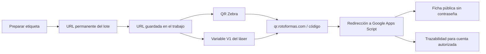

# QR de lotes: invitados, empresa, Zebra y láser

> Versión pública: las direcciones, usuarios, identificadores de adaptadores y
> valores de configuración son marcadores o ejemplos. Los datos reales y las
> credenciales se conservan en la documentación operativa privada.

Documentado el 10/11/2026. Recoge la implantación y comprobaciones realizadas
del 5 al 9 de noviembre; no implica una nueva publicación en producción.

## Comportamiento acordado

Cada lote terminado tiene su enlace corto único y permanente. Todas las piezas
del mismo lote lo comparten. El QR no identifica una pesada o pieza física
individual. Un nuevo lote obtiene otro código; los códigos no se reutilizan.

Zebra y láser reciben exactamente la misma URL del trabajo. El dibujo del QR
puede ser diferente porque cada equipo lo genera con sus propios parámetros.
La equivalencia se comprueba leyendo la URL, no comparando el dibujo.

El servicio de `qr.rotoformas.com` solo redirige al destino de Google Apps Script
que ya existía. Google determina la vista según la sesión y la autorización:

| Visitante | Vista |
| --- | --- |
| Sin sesión o sin cuenta autorizada | Ficha pública reducida del lote exacto |
| Cuenta de empresa autorizada | Trazabilidad interna completa, como antes |

La ficha de invitado no requiere contraseña, clave del servicio ni acceso a
Holded. Tener cualquier cuenta Google o una cuenta no autorizada no concede
acceso a la trazabilidad interna. Se conserva la lista autorizada del servidor.

## Ficha de invitado

Presenta el nombre de la pieza y estos campos, con los textos acordados:

- **Fecha de fabricación**.
- **Lote materia prima (Polietileno)**, correspondiente al antiguo Lote PE.
- **Lote de esta pieza**, correspondiente al antiguo Lote PT.

Además muestra la foto del producto si Holded dispone de ella. No muestra peso,
desviación, operario, observaciones, turnos ni otros datos internos. Excluye los
registros de fabricación sin unidades aceptadas. Nunca mezcla otro lote ni
resuelve búsquedas parciales como si fueran un lote concreto.

La petición de «solo la última pieza» se implantó como **una sola ficha de
fabricación aceptada más reciente del lote**: fecha más reciente y, a igual
fecha, último registro de la hoja. No es una identificación individual del
último pesaje. Los registros no conformes no pueden producir una etiqueta
desde la cola automática. Un registro posterior sin unidades aceptadas no
sustituye la ficha pública aceptada anterior.

Foto: llamada de servidor `GET /api/v2/products/{productId}/image` de Holded.
Se resuelve por SKU en el catálogo, usando el padre si el producto es variante.
El navegador recibe una URL HTTPS de imagen validada; no recibe el token ni
la respuesta completa de Holded. Caché de diez minutos. Si la foto falta o
Holded falla, los datos del lote siguen disponibles sin detalles del error.

Estos cambios afectan a la consulta de invitado. La etiqueta conserva producto,
SKU, lote, peso bruto, fecha, OF, número interno de pieza y formato 100 × 150 mm.
El enlace corto reduce la cantidad de datos del QR; no cambia automáticamente
las dimensiones físicas configuradas en la impresora o en el diseño láser.

## Recorrido del enlace corto

La primera etiqueta crea la relación lote/código. Las siguientes solicitudes
reutilizan ese código automáticamente, sin nuevas páginas, archivos o DNS por
lote. La asignación se conserva en el registro privado del alojamiento.
La configuración y recuperación están en [Enlaces cortos](ENLACES-CORTOS.md).

Ejemplo ilustrativo: `https://qr.rotoformas.com/CODIGO_DEL_LOTE`, asociado a
`SKU-EJEMPLO-112026-OF0001`. La URL y el lote anteriores son ejemplos; los valores reales se conservan
en el registro operativo privado.

## Preparar etiqueta y reimpresión

El servidor valida un pesaje guardado, su estado aceptado y el plazo de
preparación automática antes de crear el trabajo. La clave `OF|Pnúmero` evita
crear dos trabajos para la misma pesada. El trabajo guarda su URL; Raspberry,
Zebra, láser y la vista previa de planta utilizan esa URL exacta.

Los trabajos ya creados conservan su enlace histórico. Activar enlaces cortos
no los reescribe ni los reenvía. Para comprobar un cambio de formato en la
cola automática hay que usar un nuevo pesaje válido y recargar la página.
No generar un pesaje ficticio en producción solo para probar impresión.

La vista previa privada pide la URL común al servidor con autorización. Abrir
la vista previa no imprime; la impresión del navegador es una acción posterior.
Preparar o reimprimir no vuelve a registrar el peso ni mueve stock.

## Corrección del enlace del láser

Se detectaron dos causas sucesivas: el puente antiguo solo aceptaba el prefijo
Google de dominio, y el controlador LC cortaba el contenido tras otro signo
`=` dentro de `seta:data#V1=URL`. Podía confirmar el paquete completo aunque
el QR efectivo quedase incompleto en `/exec?lote`.

Los QR largos nuevos se hicieron compatibles mediante `/exec?lote/LOTE`, sin
otro `=`. Apps Script también interpreta el lote si Google lo entrega como
clave de `e.parameter`, además de `queryString`. Los enlaces cortos actuales
no contienen esa query y conservan la compatibilidad de los QR largos impresos.

El puente envía únicamente V1 y, tras la confirmación, consulta `get_currtext`
para exigir que B1 contenga la URL completa. Un ACK no coincidente o una lectura
incompleta se consideran resultado incierto y no se reintentan automáticamente.
El puente no envía órdenes de cargar diseños, iniciar o detener el marcado.

B1/B2/B3 son nombres devueltos por el controlador. No se confirmó que V2/V3
correspondieran a B2/B3: el envío autorizado a esas variables fue aceptado pero
no cambió esos contenidos. No añadir V2/V3 al programa ni editar objetos
desconocidos basándose solo en esos nombres. El usuario confirmó posteriormente
que el enlace del QR visible coincidía con el de Zebra.

## Recuperar QR PRUEBA desde la pantalla

Se borró accidentalmente la copia del diseño y dejó de figurar en la lista de
archivos. La carga solicitada devolvió `load:0`; estaba abierto QR VARIABLE.
El usuario recreó una copia llamada **QR PRUEBA** y confirmó su funcionamiento.

Para reconstruirla desde un diseño base conocido:

1. Guardar una copia como QR PRUEBA desde el panel del láser.
2. Seleccionar el QR y editar su contenido.
3. Dejar únicamente Datos externos / External Data; el campo **Variable name**
   debe ser **V1**, en mayúsculas. Cambiar solo el texto de ejemplo VData no
   demuestra que la variable tenga ese nombre.
4. Eliminar texto fijo o enlaces concatenados y guardar el diseño.
5. Comprobar que el envío de V1 se acepta y que el contenido efectivo coincide
   con la URL completa, antes de marcar una pieza conforme al procedimiento local.

La recreación requiere comprobar tamaño, posición y parámetros del diseño
base: no se documentó una recuperación byte por byte del archivo borrado.
SSH permitió consultar/cargar archivos existentes y enviar contenido; no se
demostró creación remota del diseño ni vinculación remota de sus objetos.

El aviso «la red de datos de comunicación está desconectada» apareció después
de un envío que sí actualizó el QR. Se verificó recepción y estado posterior
sin errores. El cierre de la conexión TCP es una hipótesis, no una causa
confirmada. Si reaparece, revisar la red y el resultado real del trabajo;
no ocultar alarmas ni repetir marcado o impresión a ciegas.

## Comprobaciones y límites

Se verificaron alta autenticada del enlace, idempotencia, redirección al lote,
consulta sin sesión, vista completa con cuenta autorizada y QR en vista previa.
El usuario confirmó que el acceso final parecía correcto. Durante la activación
del enlace corto no se imprimieron etiquetas ni se enviaron variables al láser;
queda separada la comprobación física del QR corto en ambos equipos.

La pantalla **Conectar enlaces QR** es una configuración administrativa en
`?modo=config-qr`, protegida por el servidor. No forma parte de la consulta de
invitado. Se dejó abierta al finalizar la instalación y provocó confusión;
se cerró y se volvió a verificar la URL corta sin sesión ni cookies. No pedir
claves a invitados ni compartir esa pantalla como enlace de una etiqueta.

La implantación de enlaces cortos usó la versión 60 el 9/11/2026. Posteriormente
GitHub documenta versiones 63 para planta/QR y 64 para gestión, con ampliaciones
de OF y materias primas. No degradar esos despliegues a la versión 60 para
reproducir una prueba antigua. Conservar IDs, permisos y enlaces distribuidos.
